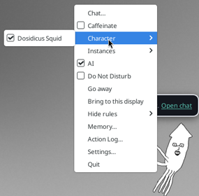

# Dosidicus Squid for Fidget

This is a character for [Fidget](https://github.com/omesser/fidget), a desktop pet, made from the squid art in [ViciousSquid/Dosidicus](https://github.com/ViciousSquid/Dosidicus).

You tell Fidget where the character is with two environment variables:

- `FIDGET_CHARACTERS` is the folder that contains the `dosidicus-squid` folder. Don't point it at `dosidicus-squid` itself. To list more than one folder, separate them with `;` on Windows and `:` on macOS and Linux.
  This tells Fidget where to find the squid, so it shows up as a character you can pick. If you set only this one, Fidget starts with the character saved in its settings (Buddy Bot on a first run). To switch, right-click the pet (or the tray icon), open **Character** and pick **Dosidicus Squid**:

  

- `FIDGET_INSTANCES=dosidicus-squid` starts Fidget with the squid as the selected character, even if you picked a different character before, so you skip the menu step.

If Fidget is already running, quit it first. Otherwise you get a second copy.

## 1. Download the character

Download [the branch as a zip](https://github.com/omesser/fidget/archive/refs/heads/character/dosidicus-squid.zip) and unzip it anywhere. You get a folder named `fidget-character-dosidicus-squid` with `dosidicus-squid` inside it. That outer folder is your `FIDGET_CHARACTERS`.

Or clone it:

```sh
git clone -b character/dosidicus-squid --single-branch https://github.com/omesser/fidget.git fidget-character-dosidicus-squid
```

The examples below assume the folder is in your Downloads folder. Change the path if you put it somewhere else.

## 2a. Run a downloaded Fidget

Get the installer for your OS from the [latest release](https://github.com/omesser/fidget/releases/latest) and install it. Then start Fidget from a terminal with the variables set.

Windows (`Fidget_<version>_x64-setup.exe`), in PowerShell:

```powershell
$env:FIDGET_CHARACTERS = "$HOME\Downloads\fidget-character-dosidicus-squid"
$env:FIDGET_INSTANCES = "dosidicus-squid"
& "$env:LOCALAPPDATA\Fidget\fidget.exe"
```

That is the installer's default location. If you picked another folder, run `fidget.exe` from there.

macOS on Apple silicon (`Fidget_<version>_aarch64.dmg`, with Fidget.app dragged into Applications):

```sh
FIDGET_CHARACTERS=~/Downloads/fidget-character-dosidicus-squid \
FIDGET_INSTANCES=dosidicus-squid \
/Applications/Fidget.app/Contents/MacOS/fidget
```

Linux with the AppImage (`Fidget_<version>_amd64.AppImage`):

```sh
chmod +x Fidget_*_amd64.AppImage
FIDGET_CHARACTERS=~/Downloads/fidget-character-dosidicus-squid \
FIDGET_INSTANCES=dosidicus-squid \
./Fidget_*_amd64.AppImage
```

Linux with the `.deb`, the binary is `/usr/bin/fidget`, so the last line becomes `fidget`.

## 2b. Run Fidget from source

You need Rust 1.95 or newer, installed with [rustup](https://rustup.rs). On Linux you also need the packages in [Linux dependencies](https://github.com/omesser/fidget/blob/main/docs/DEVELOPMENT.md#linux-dependencies). The rest of the setup is in [docs/DEVELOPMENT.md](https://github.com/omesser/fidget/blob/main/docs/DEVELOPMENT.md).

Clone Fidget and run it from the repo root. The first build takes a few minutes.

macOS or Linux:

```sh
git clone https://github.com/omesser/fidget.git
cd fidget
FIDGET_CHARACTERS=~/Downloads/fidget-character-dosidicus-squid \
FIDGET_INSTANCES=dosidicus-squid \
cargo run --bin fidget
```

Windows, in PowerShell:

```powershell
git clone https://github.com/omesser/fidget.git
cd fidget
$env:FIDGET_CHARACTERS = "$HOME\Downloads\fidget-character-dosidicus-squid"
$env:FIDGET_INSTANCES = "dosidicus-squid"
cargo run --bin fidget
```
